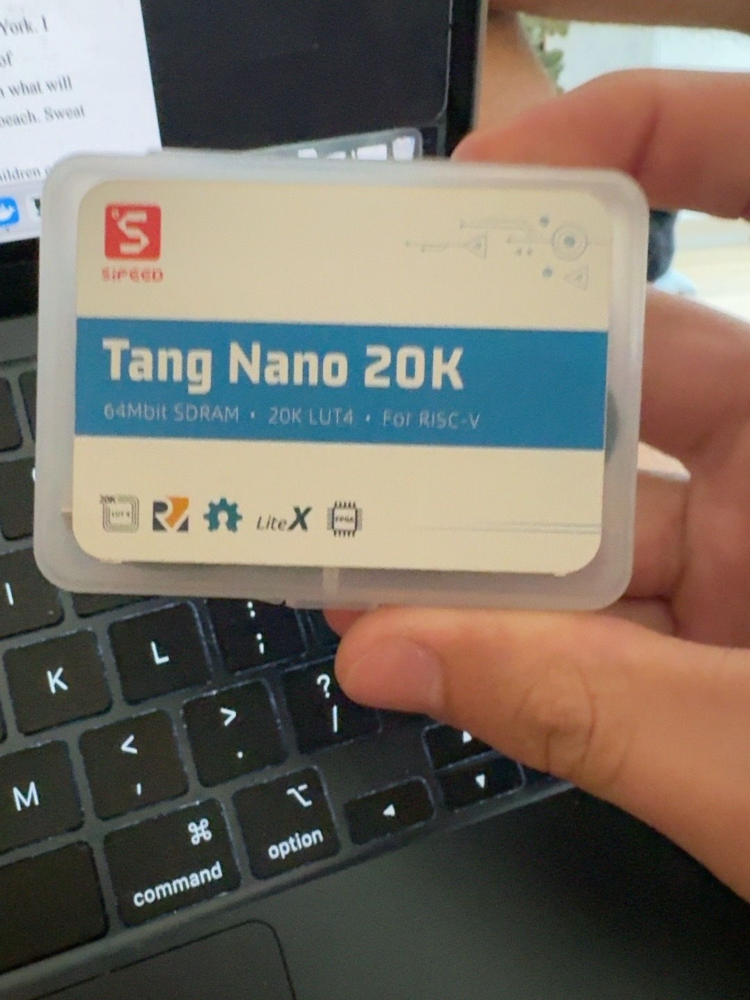

# Development log

## Notes carried over from the supplied starter (October 19, 2026)

The original archive contained a Tang Nano 20K LED-blink bring-up log. These observations were **copied from that archive**; the current package preparation did not repeat the physical test.

- Computer recorded: Apple Silicon Mac (`arm64`).
- Board identified over JTAG as Gowin `GW2A(R)-18(C)` by `openFPGALoader --detect`.
- Tools reported: Yosys 0.70+16, nextpnr-himbaechel 0.11.1-63, openFPGALoader 1.1.1.
- LED example: 27 MHz clock on pin 4, LED0 on pin 15 (active-low), half-second counter period.
- `openFPGALoader -b tangnano20k blink.fs` reported `Load SRAM 100%` and `DONE`.

That log supports an earlier bitstream upload. It is **not evidence that the RV32I CPU design ran on the FPGA**, and no independent video of the blink was included.

## New entries

Add new entries in [MY_WORK.md](../MY_WORK.md) when you actually run commands, change code, or test the hardware. Include failures too; they are useful when trying to understand the design.

*The photo is of the kit case, not an FPGA demonstration.*
